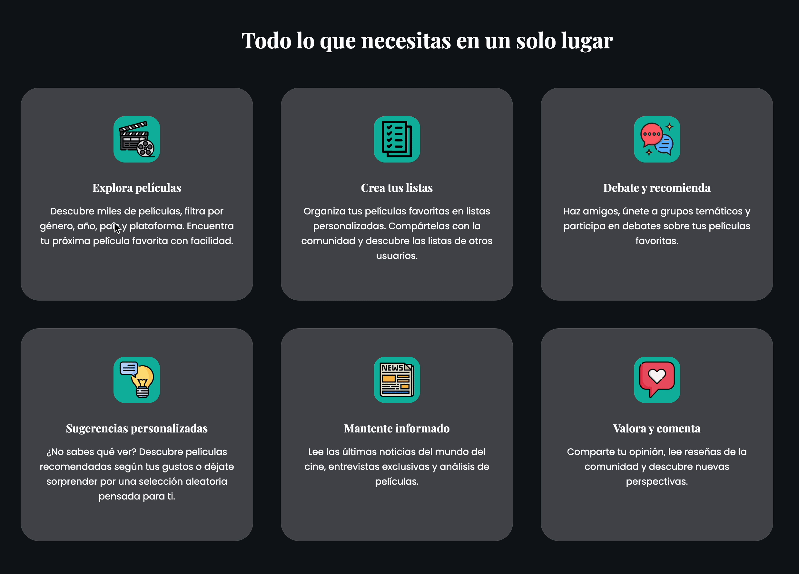

# TakeOne
Plataforma cinematográfica social con diario personal, listas, chat en tiempo real y recomendaciones. Proyecto final DAW.


<div align="center">


# TakeOne

**Un espacio para quienes aman las películas.**


[🎬 Ver demo en vivo](https://takeone.gt.tc) · [📖 Documentación del proyecto](#documentación)

</div>

---



---

## ¿Qué es TakeOne?

TakeOne es una plataforma cinematográfica social que combina el diario personal de películas con una comunidad activa. Los usuarios pueden descubrir películas, crear listas, unirse a grupos de debate y chatear en tiempo real — todo en un mismo sitio.

Desarrollada como proyecto final del Grado Superior de DAW, representa más de un ciclo de trabajo continuo: desde el diseño de la base de datos hasta el despliegue en producción.

---

## Funcionalidades principales

- 🎥 **Catálogo de películas** con filtros por género, año, país y plataforma de streaming
- 📋 **Diario personal** — marca películas como vistas, pendientes o favoritas
- ⭐ **Valoraciones y comentarios** con sistema de corazones y opción de marcar spoilers
- 📝 **Listas personalizadas** con visibilidad configurable (pública, amigos o privada)
- 💬 **Chat en tiempo real** — grupos temáticos y mensajes privados entre amigos
- 🎲 **Sistema de sugerencias** — recomendaciones por géneros, gustos o aleatorias
- 📰 **Noticias de cine** — cartelera actual y próximos estrenos en España
- 👤 **Perfil personalizable** con avatar, biografía, localidad y géneros favoritos
- 🛠️ **Panel de administración** con gestión completa de usuarios, contenido y moderación

---

## Stack tecnológico

| Capa | Tecnologías |
|------|-------------|
| Frontend | HTML5, CSS3, JavaScript (ES6), Bootstrap 5.3.2 |
| Backend | PHP 8.2 |
| Base de datos | MariaDB (MySQL) — 26 tablas |
| Comunicación | AJAX / Fetch API |
| APIs externas | TMDB (The Movie Database) |
| Iconografía | Material Icons, Font Awesome |
| Tipografía | Poppins, Playfair Display (Google Fonts) |
| Despliegue | Apache · InfinityFree hosting |
| Entorno local | XAMPP |

---

## Capturas

### Sección principal


### Menú de usuario


### Sistema de sugerencias


### Comunidad y chat


---

## Instalación local

```bash
# 1. Clona el repositorio
git clone https://github.com/tu-usuario/takeone.git

# 2. Copia los archivos en la carpeta htdocs de XAMPP
cp -r takeone/ /xampp/htdocs/

# 3. Importa la base de datos
# Abre phpMyAdmin, crea una base de datos llamada 'takeone'
# e importa el archivo SQL de la documentación

# 4. Configura la conexión en includes/conexion.php
# Ajusta host, usuario, contraseña y nombre de base de datos

# 5. Arranca Apache y MySQL desde el panel de XAMPP
# y accede a http://localhost/takeone
```

### Usuarios de prueba

| Rol | Usuario | Contraseña |
|-----|---------|------------|
| Admin | `adminmaria` | `Adminmaria1234!` |
| Usuario | `mariamv` | `Maria1234!` |

---

## Arquitectura del proyecto

```
TakeOne/
├── admin/          → Panel de administración
├── ajax/           → Endpoints de la API interna
├── css/            → Estilos (styles.css, admin.css, responsive.css)
├── img/            → Imágenes del sitio
├── includes/       → Archivos reutilizables (conexion, head, header, footer)
├── js/             → Scripts JavaScript
├── uploads/        → Imágenes subidas por los usuarios
└── index.php       → Página de entrada
```

---

## Aspectos técnicos destacados

- **Chat en tiempo real** mediante polling AJAX cada 4 segundos, cargando solo mensajes nuevos a partir del último `id_mensaje` recibido
- **Autenticación segura** con `password_hash()` / `password_verify()` y sesiones PHP
- **Consultas preparadas con PDO** en todos los endpoints para prevenir inyecciones SQL
- **Sistema de sugerencias en tres niveles**: por géneros del usuario → géneros favoritos del perfil → aleatorio como fallback
- **Doble entorno** con `conexion.php` configurado para detección automática local/producción
- **Compatibilidad con InfinityFree**: triggers reemplazados por lógica PHP inline al no estar soportados en el hosting

---

## Documentación

- [Manual de usuario](doc/manual-usuario.md)
- [Manual de administrador](doc/manual-admin.md)
- [Script SQL](doc/takeone.sql)

## Autora

**María Martín Vélez**
Proyecto Final · Grado Superior DAW
IES Suárez de Figueroa, Zafra · Junio 2026